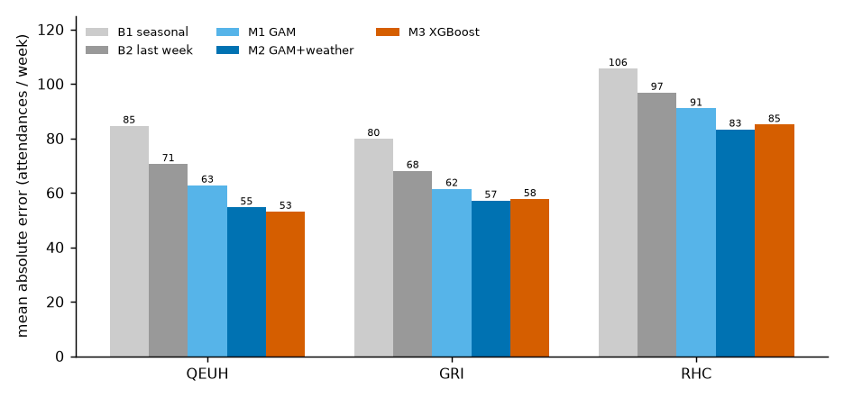
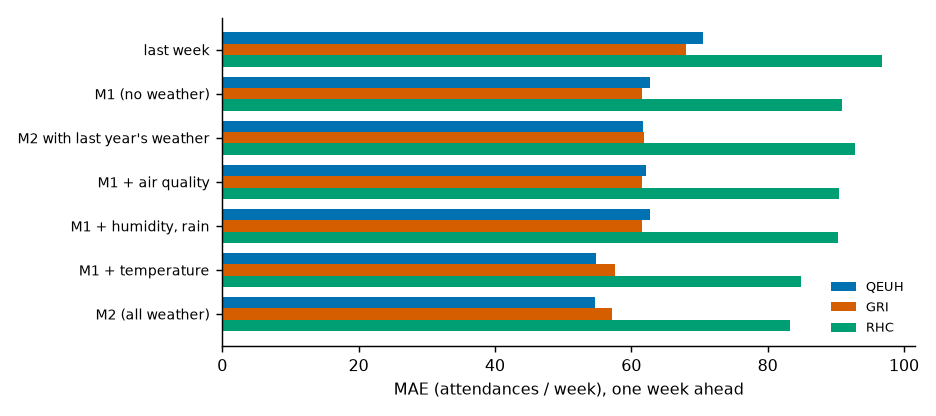
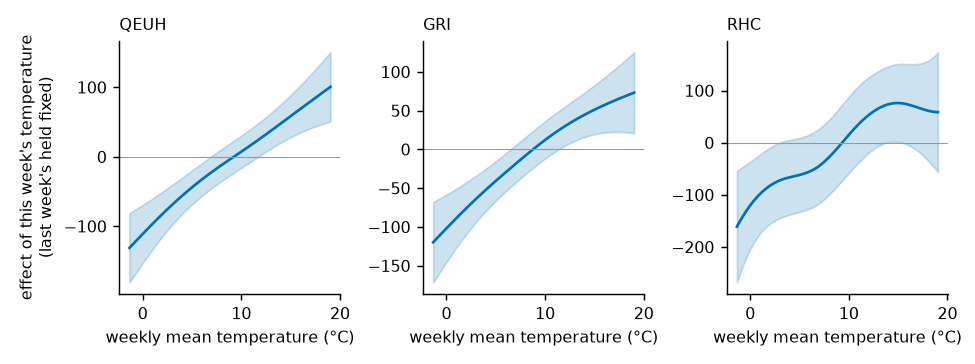

# Results: weather and air quality for forecasting weekly A&E attendance in Glasgow

Produced by the scripts in this folder (see "Reproduce" at the end). Every number below comes from
`results/results_tables.md`, which is generated from the CSV outputs, and is checked by `check_results.py`
(that script proves the numbers match the CSVs, not that the interpretation is right).
**Draft for the student to rewrite in their own words** (university AI-writing policy).
Revised after an independent code and claims review; see "Honest limits".

## 1. What was run
- **Data:** 609 weeks (22 Feb 2015 to 18 Oct 2026) of unplanned A&E attendance at QEUH, GRI and RHC, with weekly
  weather (ERA5-Land) and air quality (CAMS). The dataset is frozen at that date so that the interim report stays reproducible.
- **Test:** 146 weeks (7 Jan 2024 to 18 Oct 2026). **Rolling origin, expanding window, every model re-fitted every week;**
  hyper-parameters are re-tuned every 26 weeks using only the data available at that origin.
- **Models:** B1 seasonal naive; B2 last week; M1 GAM with last-week, two-weeks-ago and last-year attendance, time of year and
  bank holidays (no weather); M2 = M1 + weather and air quality; M3 XGBoost with all features (mean of 3 seeds);
  M3a XGBoost without weather.
- **Primary comparisons (named before reading the tables):** one week ahead, all weeks used in training, M2 vs M1 (H1) and
  M2 vs B2 (H2) at QEUH and GRI. Everything else (other horizons, other models, RHC, ablations, alerts) is secondary or exploratory.
- **Tests:** two-sided Diebold-Mariano (absolute error, small-sample correction), 5% level, Holm-corrected across QEUH and GRI
  for each comparison. RHC is exploratory and uncorrected. About 540 tests were run in total; Holm covers only the two
  hospitals within each comparison, not the whole set. M2 contains M1 (nested models), for which the standard Diebold-Mariano
  asymptotics are approximate: significant results are likely conservative, borderline ones are not decisive.
- **Important:** M2 and M3 use the *observed* weather of the target week (a "nowcast"). Every "M2 beats ..." statement
  below that does not say otherwise holds for observed weather. Section 5 tests real forecast weather.

## 2. Main result (one week ahead, observed target-week weather)
| MAE (attendances / week) | QEUH | GRI | RHC |
|---|---|---|---|
| B1 seasonal naive | 84.6 | 79.8 | 105.6 |
| B2 last week | 70.6 | 68.1 | 96.8 |
| M1 GAM, no weather | 62.8 | 61.5 | 91.0 |
| M2 GAM + weather | 54.7 | 57.2 | 83.3 |
| M3 XGBoost, all features | 53.1 | 57.7 | 85.0 |
| M3a XGBoost, no weather | 56.7 | 60.2 | 86.7 |



- **H2 (beats the baselines): supported with observed weather.** M2 beats last week by 22.5% (QEUH) and 16.0% (GRI), and
  beats seasonal naive by more; all Holm p < 0.001. At RHC (exploratory) the gain over last week is 13.9%.
  With real forecast weather the GRI gain falls to 13.2% (Section 5).
- **H1 (weather adds value over the same model without weather): supported at QEUH, borderline at GRI.**
  QEUH: MAE 54.7 vs 62.8 (-8.1, a 12.9% reduction), Holm p < 0.001. GRI: 57.2 vs 61.5 (-4.3, 7.1%), plain test p = 0.054, so the
  null is **not rejected at 5%**; but with a Newey-West variance (3 and 8 lags) the same comparison gives p = 0.024 and 0.015.
  GRI is therefore **inconclusive**: the effect points the same way as at QEUH but is smaller and not firmly established.
  RHC (exploratory): -7.7, p = 0.002 uncorrected.
- **Weather accounts for about half of the improvement over last week at QEUH:** M1 alone gives 11.1% skill, M2 gives 22.5%.
  The other half comes from calendar and autoregressive terms (bank holidays, time of year, longer lags).
- **XGBoost is no better than the GAM at one week ahead.** M3 vs M2: p = 0.935 (QEUH, GRI, Holm).
  (At two weeks ahead M3 is lower than M2 at QEUH, 54.1 vs 59.6, raw p = 0.029, Holm 0.059: not significant after correction.)
  M3 beats M3a at QEUH by 3.5 (raw p = 0.046, Holm 0.091), i.e. not significant after correction.

## 3. Which factors matter


| MAE, one week ahead | QEUH | GRI | RHC |
|---|---|---|---|
| M1 no weather | 62.8 | 61.5 | 91.0 |
| M1 + air quality only | 62.2 | 61.6 | 90.5 |
| M1 + humidity and rain only | 62.8 | 61.6 | 90.4 |
| M1 + temperature only | 54.9 | 57.7 | 84.8 |
| M2 all weather | 54.7 | 57.2 | 83.3 |
| M2 fed *last year's* weather (placebo) | 61.8 | 61.9 | 92.8 |

- **Temperature carries the whole gain.** Air quality, humidity and rain add nothing (all p > 0.4 at QEUH and GRI).
  Temperature alone is as good as all weather combined (QEUH p = 0.667).
- **It is not just seasonality.** Feeding M2 the weather of the *same week last year* removes the gain (QEUH 61.8 vs M1 62.8).
  The week-specific temperature is what helps.
- **What the temperature association looks like (fitted GAM; predictive association, not a causal effect).**
  The model uses both this week's and last week's temperature. Moving only this week's temperature from the 5th to the
  95th percentile (2.1 to 16.0 °C) while last week's stays average is associated with about 150 more attendances at QEUH
  (8.1% of the mean), 132 at GRI (8.0%) and 153 at RHC (11.5%). But if last week's temperature moves with it (a sustained warm
  period against a sustained cold one) the association shrinks to 38 at QEUH (2.0%), 23 at GRI (1.4%) and -28 at RHC.
  So the signal is mainly **the week-to-week change in temperature**: about 9.6 more attendances at QEUH and 9.8 at GRI for each
  degree a week is warmer than the last (about 0.5% of a week's attendance). Temperatures in the test period stayed below 18 °C,
  so this says nothing about heatwaves.
- XGBoost agrees on what matters: after last week's attendance, the most important features are maximum temperature, time of year
  and last week's temperature (permutation importance, `results/xgb_permutation_importance.csv`).


*(Plot: this week's temperature term with last week's temperature held fixed.)*

## 4. Robustness
- **Flagged weeks (one week ahead).** Excluding flagged weeks from *training* leaves the conclusion unchanged
  (QEUH: M2 52.3 vs M1 60.6; GRI: 56.3 vs 60.5; RHC: 77.7 vs 86.8). The test weeks contain no flagged week.
  At four weeks ahead the QEUH advantage of M2 over M1 is no longer significant when flagged weeks are excluded
  (Holm p = 0.236), so the longer-horizon result is less stable.
- **Longer horizons (2 and 4 weeks).** M2 beats M1 at QEUH (Holm p = 0.002 at both) but not at GRI or RHC.
  **These horizons are not realistic forecasts:** the model is given the observed weather of the target week, which nobody
  knows 2 to 4 weeks ahead. Treat them only as upper bounds.
- **Alerts (high = above the 90th percentile of the previous 52 weeks), one week ahead, observed weather, model M2.**
  At QEUH, M2 raises 11 alerts for 21 high weeks: precision 0.64 (95% interval 0.35 to 0.85), recall 0.33 (0.17 to 0.55) and
  0.12 false alarms a month. Last-week persistence has recall 0.43 but precision 0.41 and 0.39 false alarms a month.
  At GRI, M2 has precision 0.55 and recall 0.44. At RHC (exploratory) M2 has precision 0.73 and recall 0.55, against 0.60 and 0.60
  for persistence. **At the two adult hospitals no model catches most high weeks, and the intervals are wide**
  (only 11 to 26 alerts per row). Section 5b repeats the evaluation for the temperature-only model M2t used in the prototype,
  for real forecast weather and for the "medium" tier.
- **Sensitivity of the tests.** A Newey-West variance leaves QEUH conclusions unchanged (Holm p = 0.001 and 0.004 for
  M2 vs M1 with 3 and 8 lags) and moves GRI H1 to p = 0.024 and 0.015.

## 5. Does it survive real forecast weather?
Archived ECMWF forecasts (Open-Meteo Previous Runs) exist only from March 2024, so this uses 135 of the 146 test weeks.
Models are trained on reanalysis and tested on the forecast available on the Sunday before each week
(weekly mean-temperature forecast error vs reanalysis: RMSE 0.68 °C, bias +0.30 °C).

| MAE | QEUH | GRI | RHC |
|---|---|---|---|
| M1 no weather | 62.4 | 62.9 | 90.7 |
| M2, observed weather (nowcast) | 54.5 | 57.3 | 83.0 |
| M2, forecast weather | 54.4 | 59.9 | 84.3 |
| M2t (temperature only), forecast weather | 54.3 | 60.0 | 83.3 |

- **QEUH keeps the whole gain:** 54.4 vs M1 62.4, Holm p < 0.001; skill vs last week 22.8%.
- **GRI keeps only part:** 59.9 vs 62.9 is no longer significant (p = 0.252), the loss against nowcast weather is significant
  (Holm p = 0.026), and skill vs last week is 13.2%, below the old 15% target.
- The temperature-only model **M2t** is as good as M2 with forecast weather, so the prototype uses it
  (needs only a temperature forecast, which exists for the coming week).

## 5b. Alerts for the prototype's own set-up: M2t, forecast weather and the medium tier
Added after the review, from forecasts that already existed (`alerts_eval.py` re-uses them; no model was re-fitted). Same rule as Section 4, one week ahead; full table in `results/results_tables.md` (T6b). The earlier alert evaluation covered only M2 with observed weather.

- **Base rates (a random alert's precision).** High weeks (above the 90th percentile of the previous 52 weeks) were QEUH 14.4%, GRI 18.5%, RHC 13.7% of the 146 weeks, more than the nominal 10%, possibly because attendance trended upwards (not tested here). Medium-or-above weeks (above the 75th percentile): QEUH 37.0%, GRI 35.6%, RHC 32.9%.
- **High tier, M2t, observed weather (146 weeks):** QEUH precision 0.64 (0.35 to 0.85), recall 0.33 (0.17 to 0.55), 0.12 false alarms a month; GRI precision 0.50 (0.31 to 0.69), recall 0.41 (0.25 to 0.59), 0.33 false alarms a month; RHC precision 0.75 (0.51 to 0.90), recall 0.60 (0.39 to 0.78), 0.12 false alarms a month.
- **High tier, M2t, real forecast weather (135 weeks):** QEUH precision 0.62 (0.36 to 0.82), recall 0.38 (0.21 to 0.59), 0.16 false alarms a month; GRI precision 0.46 (0.29 to 0.65), recall 0.46 (0.29 to 0.65), 0.45 false alarms a month; RHC precision 0.86 (0.60 to 0.96), recall 0.67 (0.44 to 0.84), 0.06 false alarms a month.
- **Against last-week persistence (forecast-weather weeks):** QEUH persistence had precision 0.41 (0.23 to 0.61), recall 0.43 (0.24 to 0.63), 0.42 false alarms a month. M2t catches a slightly smaller share of high weeks (0.38 against 0.43) with fewer false alarms at QEUH; at GRI the intervals overlap (persistence: precision 0.36 (0.20 to 0.55), recall 0.35 (0.19 to 0.54), 0.51 false alarms a month), so no advantage is shown there.
- **Medium tier (M2t, observed weather):** QEUH precision 0.60 (0.46 to 0.74), recall 0.48 (0.35 to 0.61), 0.51 false alarms a month; persistence: precision 0.47 (0.34 to 0.61), recall 0.43 (0.30 to 0.56), 0.77 false alarms a month. Better than chance but only modestly informative, and the intervals overlap with persistence. The prototype therefore keeps the medium tier as watch-only, with no approval step.
- **Reading.** At the two adult hospitals the high-tier alert is about 2.4 to 4.5 times more precise than a random alert (precision divided by the base rate in each row), and still catches only about a third to a half of high weeks. Its advantage over persistence is fewer false alarms at QEUH, not more catches. Each row rests on 11 to 26 alerts, so the intervals are wide and these are descriptive results, not tested differences. The Wilson intervals also treat weeks as independent, but high weeks cluster in time, so the true uncertainty is probably larger than the intervals show.


## 6. Honest limits
1. **One test period, 146 weeks**, one city, one weather grid cell for all hospitals; weekly totals only (no diagnoses).
2. **Predictive, not causal.** Warmer weeks may coincide with other things (school terms, infection waves, events).
   No infection data were available. Do not claim temperature *causes* more attendances.
3. **Not a real-time evaluation.** The forecasts assume last week's attendance is known on the Sunday night, but PHS publishes
   with a delay, so a real operator would forecast from older data and with longer weather lead times. The analysis uses final
   data; one week was revised between the frozen and a refreshed download (QEUH, week ending 18 Oct 2026: 2019 vs 2026), so
   the last test week is provisional.
4. **Post-hoc analyses.** The model specifications and hyper-parameter grid were set before the experiments were run, to the
   author's knowledge, but there is no version history to prove it and the interim report already used this test split.
   The ablation (M2t) and placebo were added afterwards, and the prototype model M2t was chosen from the ablation. M2t differs
   from M2 by only 0.2 MAE at QEUH, but the choice used test information.
5. **Many tests; nested models.** See Section 1: Holm covers two hospitals per comparison; the Diebold-Mariano test is
   approximate for nested models.
6. **Weather is reanalysis**, not station records; air quality is modelled, not measured.
7. **Deviations from the interim plan:** hot/cold day thresholds are the 90th percentile of daily maximum (18.3 °C) and the
   10th percentile of daily minimum (-0.7 °C) before 2024, not "set from the GAM curves". Bank holidays use the Scottish
   calendar (`holidays` package); local holidays and school terms are not included. In the experiments the flag rule uses the
   pre-2024 median (the interim report used the full-sample median, so its flagged-week counts differ by a few weeks).
8. **Practical threshold.** If the old 15% gain over last week is the target, M2 meets it at QEUH and GRI with observed weather
   and at QEUH only with forecast weather. The threshold should still be agreed with the supervisor.

## Reproduce
```
cd analysis
python3 -m venv .venv && . .venv/bin/activate && pip install -r requirements.txt
python -I run_experiments.py          # about 3 minutes; main results, tests, HAC check, alerts
python -I robustness.py               # ablation and placebo
python -I forecast_weather_test.py    # archived-forecast experiment (downloads once, cached)
python -I alerts_eval.py              # alerts for M2t, forecast weather and the medium tier (re-uses the forecasts above)
python -I make_figures.py && python -I make_tables.py
python -m pytest tests                # 18 tests, including no-look-ahead checks at 1, 2 and 4 weeks
python -I check_results.py            # confirms numbers in this file match the CSVs
```
